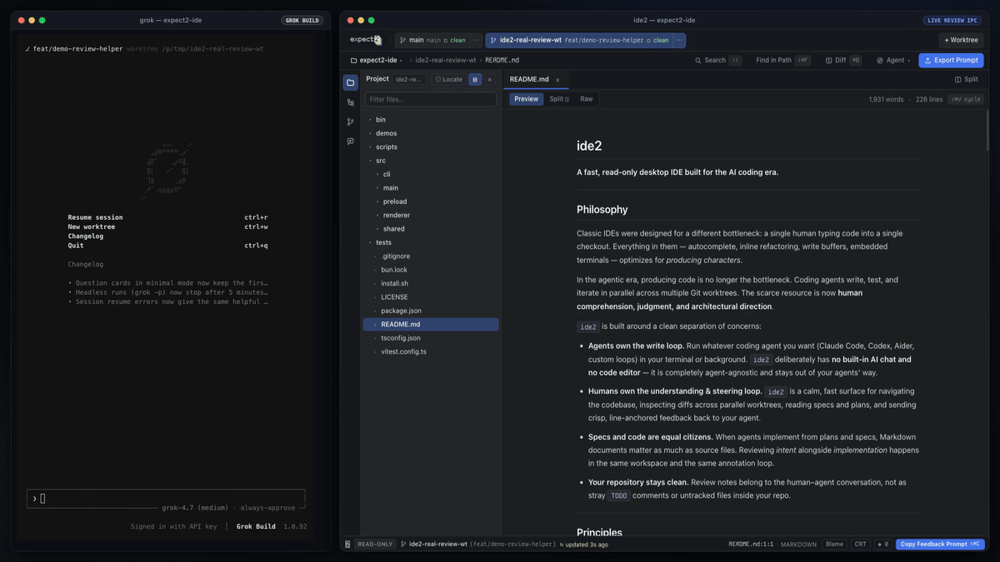
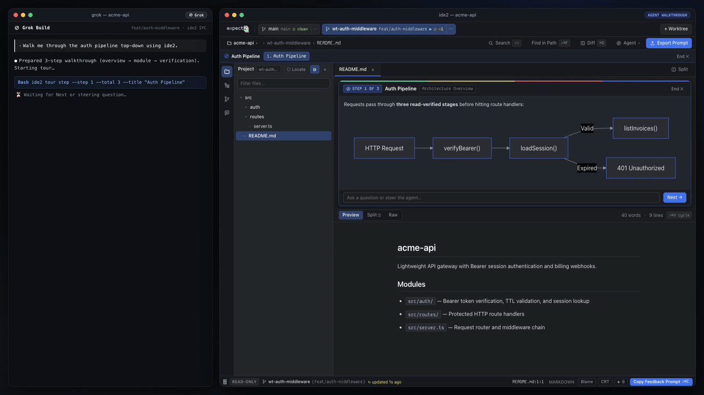

<p>
  
</p>

**A fast, read-only desktop IDE built for the AI coding era.**

---

## Philosophy

Coding agents belong in the terminal. Most of the time, staying in the terminal is enough — you point an agent at a task, let it iterate, and move on without reading every line it writes.

And your IDE shouldn't *be* your agent. Bundling an AI harness inside an editor locks you into one vendor's loop right when you want the freedom to run Claude Code, Grok Build, Codex, Pi, or your own scripts — often side by side across Git worktrees.

**Until the moments when you actually need to look at the code.** A subtle diff, an unfamiliar subsystem, a spec that drifted from implementation, or a design call you can't make from terminal scrollback. Opening a traditional IDE just to *read and steer* brings along everything built for manual typing: mutable buffers, heavy background indexing, `.git/index.lock` collisions, and another AI sidebar competing for control.

`ide2` is built for those moments:

- **Zero harness lock-in.** Keep your agents in the terminal and switch or mix them freely. `ide2` has **no built-in AI chat and no text editor** — any agent can drive it or listen to it through simple CLI commands.
- **High-bandwidth when you step in.** Ask your terminal agent to walk you through the codebase top-down inside `ide2` (`ide2 tour`), or annotate diffs, code, and Markdown specs and send structured feedback straight back into the agent's loop (`ide2 review`) — no copy/paste.
- **Strictly read-only & invisible to Git.** `ide2` never edits files, never acquires Git locks (`--no-optional-locks`), and stores annotations outside your repository (`~/.expect2-ide/`). Leave it open across all your active worktrees; it will never step on a running agent.
- **Simple, minimal, malleable.** Because it drops decades of manual-editing machinery, `ide2` stays calm on screen and small under the hood — a clean, hackable codebase with plain CLI/IPC primitives that you (or your coding agent) can reshape to fit your workflow in minutes.

---

## Principles

1. **Read-only by design** — No editor buffers, no staging, no commits, and `--no-optional-locks` on every Git call. Safe to leave open while agents write, rebase, and test.
2. **Agent-agnostic, IPC-connected** — Works with any CLI agent over local IPC (`ide2 tour` & `ide2 review`), with one-click prompt/CLI fallbacks (`⇧⌘C`, `ide2 --export`).
3. **Worktrees & specs as first-class citizens** — Switch parallel agent worktrees in one strip, and review rendered Markdown plans/Mermaid diagrams alongside diffs in the same annotation loop.
4. **Minimal surface, JetBrains speed** — Calm dark UI, keyboard-first navigation (`Shift+Shift`, `⌘⇧O`, `⌘E`, `⌘⇧F`, `⌘B`, `⌘D`, `F7`), virtualized viewports, Tree-sitter outlines, and `ripgrep` search without heavy indexing.
5. **Malleable software** — Small, readable TypeScript stack with zero cloud lock-in; point your favorite coding agent at `ide2` itself whenever you want a new workflow.

---

## Key Features

### Live Code Review Loop (`ide2 review`) — Zero Copy/Paste



- Connect any coding agent directly to `ide2` over local authenticated IPC (automatically falls back to a filesystem mailbox inside no-network sandboxes).
- Tell your agent to wait for your review (`ide2 review wait --diff`), or click **Agent ▾ → Copy Live Review Prompt** in the top bar (or install the unified skill once with `ide2 install-skill`).
- While connected, `ide2` shows a live **Agent connected & waiting for review** bar and promotes **Send to Agent →** and **Approve ✓** buttons across the top bar, Annotations panel, and Export modal.
- Annotate code, diffs, or Markdown specs as usual, then click **Send to Agent →** — compiled Markdown feedback is delivered straight to the agent's `stdout` (no clipboard needed), and `ide2` switches to *Agent addressing your feedback…* until the next round arrives or you click **Approve ✓**.
- Works seamlessly alongside `Copy Prompt` (`⇧⌘C`) and `ide2 --export` whenever no agent is actively connected.

### Agent-Driven Codebase Walkthroughs (`ide2 tour`)



- Ask **any** coding agent (Claude Code, Codex, Grok Build, Pi, Aider, etc.) to walk you through a repository or feature top-down.
- The agent prepares the full walkthrough up front and drives `ide2` **one step at a time** via `ide2 tour step` — moving from architecture overview → folders → files → spotlighted line ranges or diffs — and renders rich Markdown + Mermaid explanations right inside `ide2`.
- Each step **waits synchronously** until you click **Next →** in `ide2` (or type a quick question/detour right on the callout card to steer the agent's next step!).
- Click **Agent ▾ → Copy Walkthrough Prompt** (`⇧⌘T` / `Ctrl+Shift+T`) in the top bar, or install the unified skill once with `ide2 install-skill` (`--claude` for `~/.claude/skills/ide2`).

### Multi-Worktree Git & Diffs
- Automatically discovers all worktrees belonging to the opened repository (including `.claude/worktrees/*` and sibling checkouts) while excluding unrelated repos.
- Always-visible **Worktree Strip** with live activity indicators, changed-file counts, and per-worktree tab sessions.
- Four diff scopes in both **Split** and **Unified** views with intra-line word diffs and `F7` / `⇧F7` hunk navigation:
  - **Branch vs Base** (`merge-base` ↔ working tree — ideal for reviewing an entire agent task)
  - **Working Tree vs HEAD** (uncommitted and untracked changes)
  - **Commit** (inspect any commit from the Git log)
  - **Worktree vs Worktree** (compare two agent worktrees side by side)
- Create new linked worktrees directly from the top bar (`+ Worktree`) or copy a worktree's path / `cd` command with one click.

### Inline Annotations & Agent Feedback Prompt
- Annotate any single line, multi-line selection, deleted diff line, or Markdown block with free-text Markdown notes (`⌘/` / `Ctrl+/` or the gutter `+` button).
- Add high-level worktree instructions in the **Annotations** tool window (`⌘6` / `Alt+6`).
- **Drift-resilient anchoring** — when an agent edits earlier lines in a file, open annotations automatically shift to the new line numbers (or flag as `OUTDATED` if the anchored lines themselves were rewritten).
- Export all open annotations for the active worktree as a clean Markdown prompt via `⇧⌘C` (`Ctrl+Shift+C`), preview & customize via `⇧⌘E` (`Ctrl+Shift+E`), or print to `stdout` from the CLI with `ide2 --export`.

### First-Class Markdown Viewer
- Switch smoothly between **Preview**, **Split** (scroll-synced), and **Raw** (`⇧⌘V` / `Ctrl+Shift+V`).
- Renders GitHub Flavored Markdown (tables, task lists, callout alerts), YAML frontmatter, Mermaid diagrams (with zoom modal), and local repository images.
- Clickable repo-relative links (including `#heading` anchors and `file.ts:42` line jumps) open directly inside `ide2`.
- Annotate rendered blocks right inside Preview — annotations map back to exact raw file line numbers.

### Navigation, Search & Multi-Window Support
- **Search Everywhere** (`Shift+Shift`), **Go to File** (`⇧⌘O` / `Ctrl+Shift+O`, press again to expand across all worktrees), **Go to Symbol** (`⌥⌘O` / `Ctrl+Alt+O`), and **Recent Files / Switcher** (`⌘E` / `Ctrl+E`).
- **Find in Path** (`⇧⌘F` / `Ctrl+Shift+F`) powered by `ripgrep` with case, whole-word, regex, file-mask, and all-worktrees filters plus live surrounding-line preview.
- **Structure** outline (`⌘7` / `Alt+7`), sticky enclosing-symbol header, **Go to Declaration** (`⌘B` / `Ctrl+B`), **Find Usages** (`⌥F7` / `Alt+F7`), and optional inline Git blame.
- **Tab ergonomics**: JetBrains-style right-click context menu (pin/unpin, close others/left/right/unmodified, split right/down, copy path, open in diff, locate in Project tree).
- **Multiple projects**: Open additional repositories in separate windows via **Window → Open Project in New Window…** (`⇧⌘N` / `Ctrl+Shift+N`), the top-bar project switcher, or `ide2 /path/to/repo`.

---

## Install

Works on **macOS**, **Linux**, and **Windows** (Git Bash / WSL).

### Prerequisites

- [Git](https://git-scm.com/)
- [Bun](https://bun.sh/) (installed automatically by the installer if missing) and/or [Node.js](https://nodejs.org/)

### Quick install (no manual clone needed)

```bash
curl -fsSL https://raw.githubusercontent.com/expect2/ide2/main/install.sh | bash
```

This installs `ide2` into `~/.expect2-ide/app`, builds it, and adds the `ide2` command to your `PATH` (typically `~/.local/bin/ide2`). Run the same command again any time to update to the latest version.

To install the binary to a custom directory:

```bash
curl -fsSL https://raw.githubusercontent.com/expect2/ide2/main/install.sh | IDE2_BIN_DIR=~/.local/bin bash
```

### Install from a local clone

```bash
git clone https://github.com/expect2/ide2.git
cd ide2
./install.sh
```

### Uninstall

```bash
rm -rf ~/.expect2-ide/app "$(command -v ide2)"
```

*(Your saved annotations in `~/.expect2-ide/workspaces/` are kept unless you remove `~/.expect2-ide`.)*

---

## CLI Usage

Run `ide2` inside any Git repository or worktree:

```bash
ide2                          # Open the repo/worktree of the current directory
ide2 /path/to/repo            # Open a specific repository or worktree
ide2 src/auth/session.ts:141  # Open a file and jump straight to line 141
ide2 --diff                   # Launch directly in Branch Diff review mode
ide2 --base develop           # Override the base branch used for diffs
ide2 --worktree api-v2        # Focus a specific worktree by name or path
ide2 --export                 # Print the active worktree's Feedback Prompt to stdout
ide2 --export --resolve       # Print the Feedback Prompt and mark annotations resolved
ide2 review wait --diff       # Live review loop: receive annotations directly (no copy/paste)
ide2 tour --help              # Agent-driven interactive codebase walkthrough commands
ide2 install-skill            # Install unified ide2 SKILL.md (~/.agents/skills/ide2)
ide2 install-skill --claude   # Install unified ide2 SKILL.md (~/.claude/skills/ide2)
```

| Flag | Description |
| --- | --- |
| `-d, --diff` | Open in Diff Review mode |
| `-b, --base <ref>` | Override the base branch ref for diffing (e.g. `main`) |
| `-w, --worktree <name>` | Select a worktree by name, branch, or path |
| `--export` | Compile and print the Markdown Feedback Prompt to stdout (headless) |
| `--resolve` | Used with `--export` to mark exported annotations as resolved |
| `--wait` | Wait until the `ide2` window closes before returning |
| `-v, --version` | Print version |
| `-h, --help` | Print help |

---

## Example Feedback Prompt

Running `⇧⌘C` (`Ctrl+Shift+C`) or `ide2 --export` produces a self-contained prompt you can paste directly into your coding agent:

````markdown
# Code Review Feedback — `wt-agent-a`

- **Worktree:** `/path/to/repo/.claude/worktrees/wt-agent-a`
- **Branch:** `feat/agent-a` @ `a1b2c3d` (base: `main` @ `9f8e7d6`)

## Overall Notes

Ensure all auth middleware paths enforce strict Bearer token validation.

---

## 1. `src/auth.ts:16-18`
```ts
16 |   const [scheme, token] = trimmed.split(' ');
17 |   if (scheme !== 'Bearer') return null;
18 |   return { userId: token.slice(0, 12), role: 'user' };
```
Guard against undefined `token` before calling `token.slice(0, 12)`.
````

---

## Keyboard Shortcuts

| Action | macOS | Linux / Windows |
| --- | --- | --- |
| Search Everywhere | `⇧⇧` | `Shift+Shift` |
| Go to File (press again for All Worktrees) | `⇧⌘O` / `⌘O` | `Ctrl+Shift+O` / `Ctrl+O` |
| Go to Symbol | `⌥⌘O` | `Ctrl+Alt+O` |
| Recent Files & Switcher | `⌘E` | `Ctrl+E` |
| Find in Path | `⇧⌘F` | `Ctrl+Shift+F` |
| Find in File | `⌘F` | `Ctrl+F` |
| Go to Line:Column | `⌘L` | `Ctrl+L` |
| Go to Declaration / Usages | `⌘B` / `⌥F7` | `Ctrl+B` / `Alt+F7` |
| Navigate Back / Forward | `⌘[` / `⌘]` | `Ctrl+Alt+Left` / `Right` |
| Toggle Diff View | `⌘D` | `Ctrl+D` |
| Next / Previous Diff Change | `F7` / `⇧F7` | `F7` / `Shift+F7` |
| Cycle Markdown Mode (Preview / Split / Raw) | `⇧⌘V` | `Ctrl+Shift+V` |
| Annotate Line or Selection | `⌘/` | `Ctrl+/` |
| Copy Feedback Prompt | `⇧⌘C` | `Ctrl+Shift+C` |
| Preview & Export Feedback Prompt | `⇧⌘E` | `Ctrl+Shift+E` |
| Switch Worktree | `⇧⌘W` | `Ctrl+Shift+W` |
| Copy Walkthrough Prompt for Agent | `⇧⌘T` | `Ctrl+Shift+T` |
| Open Project in New Window | `⇧⌘N` | `Ctrl+Shift+N` |
| Tool Windows: Project / Annotations / Structure / Git | `⌘1` / `⌘6` / `⌘7` / `⌘9` | `Alt+1` / `Alt+6` / `Alt+7` / `Alt+9` |
| Split Editor Right / Close Tab | `⌘\` / `⌘W` | `Ctrl+\` / `Ctrl+W` |

---

## Development

```bash
bun install           # Install dependencies
bun run build         # Build main, worker, preload, renderer, and CLI bundles
bun run typecheck     # Run TypeScript typechecking
bun test              # Run the test suite
bun start             # Build and launch ide2 on the current repository
```

---

## License

[MIT](./LICENSE)
